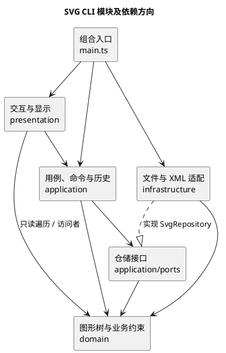

# Lab1 Phase 1：SVG 编辑器（CLI）

## 项目信息与当前状态

- Git 仓库地址：[MrZZZZZZZZZZ/svg-editor-lab1](https://github.com/MrZZZZZZZZZZ/svg-editor-lab1)。
- 需求依据：[phase_cli_1.md](./phase_cli_1.md)。
- 当前阶段：架构方案与验收计划。已确认远程仓库可访问，并在本目录初始化 Git、关联远程地址；尚无功能代码或测试结果，因此本文不宣称实现已完成。
- 文档位置：按本次要求保存为 `个人lab1/README.md`；正式按附件提交时，还需将最终文档放入工程的 `doc/README.md`。

项目目标是使用 TypeScript 和面向对象方式实现 SVG 命令行编辑器：通过 `svg>` 交互提示符操作图形树，支持 SVG 读写、图形编辑、结构显示和撤销重做。Phase 1 内置 `rect`、`circle`、`ellipse`、`line`、`text`、`g` 六类元素；`box` 和动态插件加载属于后续阶段。

## 一、架构方案

以下类名和目录为拟议方案，须在实现后根据实际代码更新。一类一文件，文件名与类名一致；对象通过方法维护自身约束，避免公共数据袋和散落的按类型分支。

### 1. 模块划分

| 目录 | 主要类或接口 | 职责 |
| --- | --- | --- |
| `src/domain/` | `SvgDocument`、`Shape`、`ContainerShape`、`Group`、`Rect`、`Circle`、`Ellipse`、`Line`、`Text`、`ShapeFactory`、`ShapeVisitor` | 维护画布、图形树、唯一 id 索引及几何行为；统一叶子与容器操作；检查属性白名单、父子关系及环路约束 |
| `src/application/` | `Editor`、`CommandHistory`、`DocumentSnapshot`、`CommandRegistry` | 编排用例，执行命令，管理历史记录与文档操作后的撤销屏障 |
| `src/application/commands/` | `Command`、`UndoableCommand` 及各具体命令类 | 封装每条命令的输入、校验、执行与恢复行为，保证一条编辑命令是一个撤销单元 |
| `src/application/ports/` | `SvgRepository` | 定义读取和保存文档的接口，隔离文件系统及 XML 实现 |
| `src/presentation/` | `Repl`、`Tokenizer`、`CommandParser`、`TreeFormatter`、`ShowFormatter` | 逐行输入、双引号分词、语法校验，以及提示符、成功摘要、警告和统一错误输出 |
| `src/infrastructure/` | `FileSvgRepository`、`SvgReader`、`SvgWriter` | 实现文件读写和 XML 编解码；读入时补全缺失 id，通过图形工厂构造对象，通过访问者输出 SVG |
| `src/main.ts` | 组合入口 | 创建各对象、注入依赖并启动 REPL；不承载业务逻辑 |
| `tests/`、`examples/`、`doc/` | 测试、SVG 与命令样例、文档 | 保存可重复执行的验收资料和架构记录 |

组件关系如下（PlantUML）：

### 2. 设计模式的选择与落地方案

#### Command：封装编辑操作与历史记录（必选）

`Command` 表达一次命令执行，编辑命令实现 `UndoableCommand`，由 `CommandHistory` 统一管理。`CreateCommand`、`MoveCommand`、`GroupCommand` 等各自拥有独立类，REPL 不直接修改图形。

预期调用链：`Repl → CommandParser → CommandRegistry → Editor / CommandHistory → 具体命令 → SvgDocument / Shape`。

- 一次编辑成功后，只向 undo 栈压入一个条目；`group`、删除子树、容器缩放也各算一个条目。
- undo 成功后将条目移至 redo 栈；redo 成功后移回 undo 栈。
- undo 后执行新的成功编辑，清空 redo 栈。解析失败、校验失败及执行失败均不修改文档或历史。
- `tree`、`show`、`help` 与无参数 `canvas` 是查询，不进入历史，也不解除屏障。
- `init`、`read`、`save` 和带参数的 `canvas` 成功后，清空旧历史并设置撤销屏障；undo/redo 输出 `error: undo not allowed after io command`。下一条成功编辑解除屏障，并开始新历史。失败的文档操作保持原状态。

#### Composite：统一图形与容器

`Shape` 声明移动、缩放、属性设置与访问者入口；叶子类实现自身几何行为，`ContainerShape` 管理有序子节点，`Group` 实现普通分组。

- `move` 和 `scale` 通过多态处理。Phase 1 采用递归修改几何数据的方案，避免同时修改子坐标与容器 transform 造成重复变换。
- 缩放因子必须为正，位置和尺寸等几何量均按要求缩放；文字内容和样式属性不随几何缩放改变。
- `g` 的 `set` 支持公共样式属性并写在容器上，继承行为交给 SVG 渲染规则；叶子支持本类型几何属性，`text` 额外支持文本内容 `text`。白名单外属性统一拒绝。
- 删除容器时移除整棵子树及其 id 索引；恢复时连同父节点位置、子树和索引一起恢复。
- 调整归属前检查目标类型和祖先关系，禁止形成环；同级节点顺序作为绘制顺序，`front` 移至列表末尾，`back` 移至列表开头。
- `ungroup` 按要求拒绝 SVG 直接子节点中的容器；合法解组时，子节点在父级中替换原容器的位置，保持内部顺序。

#### Memento：保障撤销完整性与失败原子性

Phase 1 拟用封装的 `DocumentSnapshot` 保存每条编辑前后的文档状态，与 Command 配合。快照包含画布、图形子树及同级顺序；恢复时重建 id 索引与父引用，不共享可变子节点。

执行前完成可预检的校验，执行中失败则恢复前态；只有完整成功才写入历史。整文档快照实现简单，适合本阶段规模；代价是每条历史的时间和空间开销随文档大小增长，后续有实际性能压力时再改为差量记录。

#### Factory、Visitor 与依赖倒置

- `ShapeFactory` 集中处理类型名到图形类的构造，导入和 `create` 共用它；未知类型按附件输出错误。
- `CommandRegistry` 集中处理命令名到命令构造器的映射。
- SVG 输出和树形显示通过 `ShapeVisitor` 访问具体图形，避免各处重复 `switch(tag)`。
- `SvgRepository` 由应用层定义、基础设施实现，应用命令不直接调用文件系统。

**按名字分派只保留两处**：`CommandRegistry` 的命令名映射和 `ShapeFactory` 的类型名映射。这两处在本阶段集中管理，明确列为后续插件化的待重构点；不在读写器、显示器或编辑命令中新增类型名分派。

### 3. 依赖方向规则

| 模块 | 允许依赖 | 理由与禁止事项 |
| --- | --- | --- |
| `domain` | 本模块及语言标准能力 | 核心模型不依赖命令行、应用层、文件系统或 XML 库 |
| `application`（含 commands） | `domain`、本层 ports | 用例消费抽象接口，不导入具体文件仓储或交互层 |
| `application/ports` | `domain` | 只定义跨边界契约，不执行具体 IO |
| `presentation` | `application`、`domain` | 输入转为用例调用；直接访问模型仅用于只读展示，禁止绕过命令修改模型 |
| `infrastructure` | `application/ports`、`domain`、文件系统及 XML 库 | 实现外部适配，不控制历史记录或终端交互 |
| `main.ts` | 上述模块 | 仅负责对象装配；业务模块不能反向依赖入口 |

检查时既看 `import` 关系，也看实际调用行为。任何越层写入、循环依赖或核心层直接 IO 均列为待处理项，不以“能够运行”作为豁免理由。

### 4. 变化点假设

| 可能变化 | 当前保留的边界或暂不实现的理由 |
| --- | --- |
| 增加 `box` 等图形类型 | 集中工厂和多态图形接口；后续再设计 `ShapeProvider` 注册、便利属性和 `data-kind` 还原机制，本阶段不承诺插件零改动接入 |
| 增加命令或换成 GUI / agent 输入 | 具体命令不依赖 REPL，保留命令注册入口；新输入通道复用应用用例 |
| 更换 XML 库或存储方式 | 用 `SvgRepository` 隔离读写，保持应用层不变 |
| 历史记录数量和文档规模增长 | 将快照封装于历史模块，后续可替换为命令差量；当前不引入磁盘历史或复杂压缩 |
| SVG 导入范围扩大 | 外部 SVG 的 transform、未知标签及其他未约定属性需单独明确兼容范围并增加用例；当前不宣称兼容任意 SVG |
| 输出样式或本地化变化 | 提示、错误与展示集中在 presentation；当前保持附件规定的英文前缀和指定错误文案 |

## 二、过程记录

本节只记录已发生的文档工作。实现阶段与 AI 的代码迭代尚无材料可核对，后续需补充实际提交和验证证据。

| 阶段 | 发现或讨论 | 处理与依据 |
| --- | --- | --- |
| 需求梳理 | 附件同时描述本阶段六类图形和后续 `box` 示例，容易误写为本阶段已支持插件 | 对照 4.4 的阶段边界，限定 Phase 1 范围，`create box` 仍应报未知类型 |
| 架构拟定 | 仅有 undo 栈不能完整表达文档操作后禁止 undo/redo 的规则 | 对照 4.3，增加独立历史屏障，区分查询、编辑与文档操作 |
| 架构拟定 | 分组、删除和归属变更需要同时维护父节点、顺序与 id 索引；只保存几何量无法完整恢复 | 采用 Command 配合文档快照的方案，将结构和索引恢复纳入验收 |
| 文档准备 | 初次编写时，本目录未提供代码、Git 配置和执行结果 | 将类名和依赖写为设计方案，将一致性及测试结果标记为待验证，未编造开发提交或测试通过记录 |
| 交付路径核对 | 本次要求放在“个人lab1”，附件正式文档路径为工程 `doc/README.md` | 当前按本次要求保存；正式提交时需同步最终文档到工程要求的位置 |
| 仓库准备 | 用户提供 GitHub 仓库地址，检查确认远程仓库为空 | 在“个人lab1”中初始化 `main` 分支并关联 `origin`，准备首次文档提交；尚未开始程序开发 |

后续每次有代表性的实现修订应记录：发现的问题、如何复现、采用的修改、验证结果和对应 commit。只有实际发生的 AI 建议纠正和测试过程才记为已完成。

## 三、一致性自查

### 1. 模块划分与实际目录是否一致？

**当前结论：待验证。** 当前可见文件为任务说明和本文，尚无 `src/`、`tests/` 或工程配置可供比对。上文目录是方案，不是对实际实现的描述。

实现后逐项比对目录、类职责与一类一文件约定；如果实际划分变化，应先更新架构图及模块表，并在过程记录中注明原因与 commit。

### 2. 依赖方向是否被违反？

**当前结论：待验证。** 未提供源代码，不能宣称无违规依赖。

实现后至少抽查：`MoveCommand` 到图形模型的调用、`ReadCommand` 到 `SvgRepository` 的调用、`FileSvgRepository` 的接口实现，以及 `domain` 是否引入终端、文件系统、XML 库或应用层。记录具体文件和检查结果，发现违规后修复或明确列为待处理项。

## 四、质量保证手段

下表为验收计划，**尚未执行，不代表测试通过**。测试应覆盖正常路径、边界条件、错误信息，以及失败后文档和历史均不改变的约束。

| 检查范围 | 关键验收点 |
| --- | --- |
| 输入与交互 | `svg>` 提示符、逐行读取、以 `#` 开头的注释行、双引号文本、中文和空格；颜色参数中的 `#` 不当成注释 |
| 文档操作 | 默认 800×600 与自定义画布；`read`、`save`、默认保存路径；无文档和文件 IO 错误；查询尺寸不影响历史 |
| 创建和属性 | 六类内置图形、根级及 `in` 创建；唯一且大小写敏感的 id；省略样式不写入属性；属性白名单和未知类型错误 |
| 几何编辑 | 各类元素移动和缩放，浮点坐标，非正缩放因子；容器递归操作，位置与尺寸同时按规则缩放 |
| 结构操作 | 删除整棵子树、分组的相对顺序、解组位置、`addto` 末尾插入、同级 front/back；自包含及祖先后代冲突拒绝且无副作用 |
| 历史行为 | 每条编辑一个单元；重复 undo/redo 精确恢复；新编辑清空 redo；查询和失败命令不改变历史；文档操作设置屏障，下一次成功编辑重新解禁 |
| SVG 读写 | 六类元素及嵌套结构 round-trip；缺 id 自动分配、避开已有 id 并打印规定警告；重复 id 拒绝；文本及属性正确 XML 转义 |
| 显示与报错 | tree 含关键几何量且支持子树；show 含父节点和属性；help 完整；错误采用 `error:` 前缀，每条一行并匹配规定文案 |
| 综合案例 | 回放附件第 6 节和 6.1 版本 A，检查图形树、撤销结果和保存文件；在浏览器中查看保存的 SVG |
| 架构与代码 | TypeScript 类型检查；类封装、多态和一类一文件；依赖方向抽查；按名字分派仅存在于规定的两处 |

验证时应保存实际启动命令、类型检查与测试命令、运行环境、测试摘要及已知限制。项目配置尚未提供，因此本文不预设已经存在的 npm 脚本，也不提供虚构的通过数量或覆盖率。

## 五、Git 与正式提交核对

附件要求全程使用 Git 管理并推送远程，以分步提交体现开发过程，并在最终提交处创建和推送 `final` 标签。最终提交前需据实核对：

- [x] 本文已填写可访问的真实 Git 仓库地址。
- [ ] 仓库包含完整代码、工程配置、测试及必要样例。
- [ ] 提交历史体现真实开发过程，未用一次性大提交替代过程记录。
- [ ] 本文已按真实实现更新，过程记录与一致性自查具有代码及提交证据。
- [ ] 正式文档已放入工程 `doc/README.md`。
- [ ] 验收已完成，执行命令、结果和剩余限制已写入文档。
- [ ] 最终提交已推送，并在截止时间前创建和推送 `final` 标签。

远程仓库地址已确定并验证可访问，本地仓库已初始化并关联远程。当前尚无功能代码及测试结果，最终提交、`final` 标签和截止时间仍待核验。
