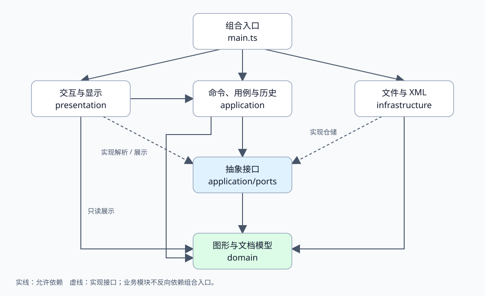
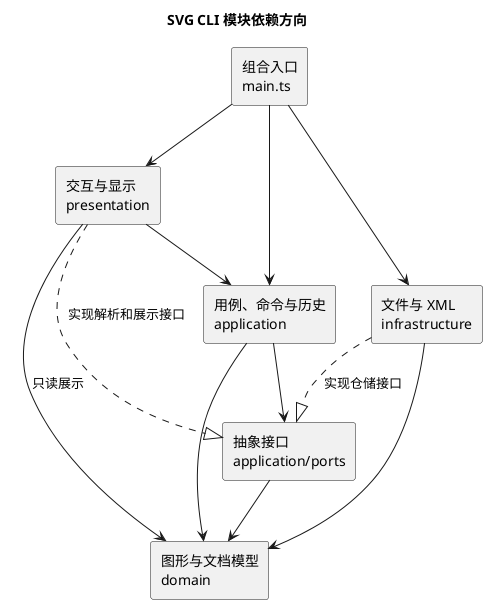

# Lab1 Phase 1：SVG 编辑器（CLI）实验报告

- Git 仓库：[MrZZZZZZZZZZ/svg-editor-lab1](https://github.com/MrZZZZZZZZZZ/svg-editor-lab1)。
- 需求依据：[phase_cli_1.md](../phase_cli_1.md)；安装与运行：[工程 README](../README.md)。
- 验证环境：macOS、Node.js 24.19.0、TypeScript 5.9.3；工程要求 Node.js 22 或更高版本。
- 实现范围：已完成 Phase 1 规定的命令和图形类型，类型检查与 63 项测试通过。`box`、动态插件和完整 SVG 标准支持不在本阶段范围内。

## 一、架构方案

### 1. 模块划分

| 模块 | 主要类或接口 | 职责 |
| --- | --- | --- |
| `src/domain/` | `Shape`、`ContainerShape`、六类图形、`ShapeFactory`、`SvgDocument`、`TransformOperations`、`XmlCharacters` | 封装属性与几何行为，维护有序图形树及唯一 id，校验父子关系、循环和 XML 字符，统一已有变换下的几何操作，不执行 IO |
| `src/application/` | `Editor`、`CommandRegistry`、`CommandArgs`、`CommandHistory`、`DocumentSnapshot`、`HistoryTransition` | 编排用例、校验参数、管理当前文档和路径、执行命令及撤销重做 |
| `src/application/commands/` | `Command`、`UndoableCommand` 及每种具体命令 | 命令对象封装一次操作；编辑的应用和恢复各有独立入口 |
| `src/application/ports/` | `SvgRepository`、`LineTokenizer`、`TreeView`、`ShapeView` | 定义存储、分词与展示契约，由入口注入实现 |
| `src/presentation/` | `Tokenizer`、`Repl`、`TreeFormatter`、`ShowFormatter` | 双引号分词、逐行交互、提示符、统一错误前缀、树与属性显示 |
| `src/infrastructure/` | `FileSvgRepository`、`svg/SvgReader`、`svg/SvgWriter` | 文件和 XML 适配、缺 id 补全、严格读取、临时文件替换保存 |
| `src/main.ts` | 组合入口 | 装配具体对象并启动 REPL，不承载业务规则 |
| `tests/`、`examples/`、`doc/` | 验收与交付材料 | 自动化检查、命令样例、SVG、正式报告 |

一类一文件，文件名与类名一致；模型字段封装，属性和子列表返回只读副本。移动、缩放、属性校验和结构变更由对象行为完成。



图的 PlantUML 描述如下，另存为 [architecture.puml](./architecture.puml)：



### 2. 设计模式与落地

#### Command（必选）

每种命令继承 `Command`，编辑类继承 `UndoableCommand`，由 `CommandRegistry` 统一构造。调用链为 `Repl → Editor.execute → 注入的 Tokenizer → CommandRegistry → 具体 Command → Editor / CommandHistory → SvgDocument / Shape`。

`CommandHistory.execute` 在文档深克隆上执行 `apply`，成功生成后态快照后才替换当前文档并更新双栈。因此失败命令不改变文档、保存路径、undo/redo 或屏障。一条分组、子树删除或容器缩放都是一个历史单元。

undo 将命令移入 redo 栈，redo 反向移动；新的成功编辑清空 redo。`tree/show/help`、空行、注释及无参数 `canvas` 不写入历史，也不清除 redo。

`init/read/save` 和带宽高的 `canvas` 成功后清空历史并设置独立屏障，undo/redo 报 `error: undo not allowed after io command`；下一条成功编辑解除屏障。失败编辑与失败 IO 都不解除屏障。

#### Composite

六类元素继承 `Shape`，`Group` 经 `ContainerShape` 管理有序子节点。move/scale 遍历共同图形契约，不按类型名分支；先验证整棵子树的新几何值，再统一应用，避免溢出部分修改。scale 同乘位置和尺寸，必须是正因子；不缩放样式或文字内容。

已有 SVG 变换下，`TransformOperations` 把每个已有变换 T 同步调整为 A·T·A⁻¹，几何同时按 A 修改；各层相邻的逆变换抵消，整棵子树在所选节点父坐标系中保持一致移动/缩放。无 transform 的元素不新增该属性，类型分派仍只有规定的两处。矩阵数值测试和实际 SVG 栅格平移对比验证了混合嵌套变换的结果。

`set` 支持公共样式、本类型几何与文字内容白名单。容器的样式保存在 `<g>` 上，由 SVG 继承规则渲染，不强制覆盖子节点显式样式。delete 容器移除整棵子树，撤销恢复子树、父链和顺序。

`group` 保留原文档前序相对顺序，跨父级时放入最近公共父容器的最早选中分支位置；祖先后代同时选择时拒绝。`addto` 追加到末尾并检查循环；front 在同级列表末尾最后绘制，back 在开头。

合法 ungroup 的子节点在父级替换原容器位置；按附件要求，根级容器禁止解组。容器接口保留拒绝解组能力，供后续复合图形使用。当前未实现 `box`。

#### Memento 与 Factory

`DocumentSnapshot` 封装独立的深克隆文档，`restore()` 再生成新副本；具体命令保存前后快照，恢复不共享可变节点。`HistoryTransition` 将恢复的文档与反馈一起交回 Editor。取舍是整文档快照增加时间和内存成本，适合本阶段规模。

`ShapeFactory` 的定义表集中构造六类元素，create 和 read 共用；`CommandRegistry` 集中命令注册。**按名字分派只有这两处，均列为后续插件化的待重构点**。当前没有动态 provider，不承诺新图形零改内核。

SVG 输出读取共同的 `attributes/children/textContent`，tree 调用多态 `describe()`，无需重复类型分支。应用使用 ports，main 注入具体实现，落实依赖倒置。

### 3. 依赖方向规则

| 模块 | 允许依赖 | 理由与限制 |
| --- | --- | --- |
| domain | 本模块与语言标准能力 | 不依赖应用、文件、终端或 XML |
| application | 本模块、ports、domain | 只消费抽象，禁止导入具体适配器 |
| ports | 本模块、domain | 只定义契约，不执行 IO |
| presentation | 本模块、application、ports、domain、Node 流/readline | 编辑经应用执行，直接访问模型仅用于只读展示 |
| infrastructure | 本模块、ports、domain、Node IO、XML 库 | 不依赖具体用例或交互层 |
| main.ts | 上述各模块 | 仅装配，其他模块不反向依赖入口 |

`architecture.test.ts` 使用 TypeScript AST 检查 import、re-export、类型导入和静态模块调用，以及一类一文件、类名文件名一致、无顶层业务自由函数。静态检查只能核对声明的依赖边，不能替代对运行时行为和职责的审查。违规依赖均须处理。

### 4. 变化点假设

| 未来变化 | 保留的边界或暂不实现的理由 |
| --- | --- |
| 更多图形、box | 集中工厂和统一图形/容器契约；provider、便利属性和插件还原留给后续阶段 |
| GUI 或 agent 输入 | 命令不依赖 REPL，新增适配可复用应用层；当前不开发 GUI |
| XML/存储更换 | SvgRepository 隔离 IO，不影响核心模型 |
| 大文档/长历史 | 快照独立封装，可替换差量存储；当前 id 扫描避免索引一致性成本，未做大规模性能优化 |
| 更复杂的 SVG/CSS/变换 | 明确限制支持范围，拒绝无法无损导入的内容；不提前引入完整渲染或矩阵系统 |
| 输出格式变化 | formatter 负责展示，REPL 负责统一前缀，命令/领域生成业务摘要和错误原因 |

## 二、过程记录

开发过程中的主要设计调整、问题修复及验证结果如下。

| 阶段 | 发现、确认与修正 | 证据 |
| --- | --- | --- |
| 需求方案 | 明确六类内置元素和命令范围，将 box 留作后续扩展，形成初步模块方案 | `d5a0064`；附件 4.4 |
| Git 准备 | 建立远程仓库，按工具链、领域模型、文件读写、命令及测试逐步提交 | `d5a0064` 及后续提交记录 |
| 工程环境 | 增加 ./lab 启动脚本，兼容系统 Node 和已有运行时，同时保留标准 npm 脚本 | `446717e`；lab/package.json |
| 模型实现 | 检查跨父级分组、顺序、循环和父链；先验证整棵子树的数值，再统一应用修改，避免溢出导致部分修改 | `ee75224`；domain.test.ts |
| SVG IO | 自动 id 可能抢占后面显式 id，改用全树预扫描；save 使用同目录临时文件替换 | `f1ecf44`；svg.test.ts |
| 集成纠正 | 发现模型允许 0 尺寸，但读取器只接受正数，导致保存后读不回；统一为非负尺寸并加两层回归 | svg.test.ts、editor.test.ts 的 zero-sized 用例 |
| 命令与历史 | 重点确认查询不解除屏障、失败编辑不清 redo、失败 IO 保持状态，回放附件完整会话 | `baf053d`；editor.test.ts |
| 方案修订 | 草案的 CommandParser、Visitor、id 索引未直接采用；实际改为 CommandArgs/具体命令校验、公共多态契约、前序查找；新增解析/展示 ports 防止反向依赖 | 本报告修订后的架构表与依赖测试 |
| 长序列验收 | 两个固定种子各执行 129 条编辑，逐步 undo 至空文档，再逐步 redo，每步比较 XML 并检查唯一 id 和父链 | history-property.test.ts |
| 交互/渲染 | 实际 PTY 检查提示符、中文、错误后继续和 Ctrl-D；回放流程图并静态渲染检查矩形、连线和中文文字 | presentation/Repl.ts；examples/flowchart.commands 与 flowchart.svg |
| 边界回归 | 发现混合变换下容器移动不一致、非法 XML 字符无法往返、只读文件被覆盖的问题；分别补充回归测试，修正变换计算、字符校验和目标文件权限检查 | transform.test.ts、xml-characters.test.ts、file-permissions.test.ts |
| 验收补全 | 按附件可选参数语法支持 canvas 只给宽度；按错误表统一普通缺失 id 与 create-in 目标文案，help 也遵守先 init/read 的要求；核对全部命令、架构和文档 | requirements.test.ts、editor.test.ts；本节末的逐项核验表 |

AI 辅助用于架构草案、代码实现、测试用例生成和错误定位。方案调整与修复结果通过代码审查、提交记录和回归测试核对。

## 三、一致性自查

### 1. 实际目录与方案是否一致？

与上文修订后的方案一致。相对最初草案的变化已记录：取消独立 CommandParser 与 Visitor，改用参数对象/具体命令和多态表示；不维护持久 id 索引，当前树按前序扫描；ports 增加解析与展示接口；SVG 适配置于 infrastructure/svg。根 README 保留项目入口，正式文档位于 doc/README.md。

源码一类一文件，类名与文件名一致。图形包含几何、属性校验和结构行为，属性与子列表为只读副本；不是公共数据袋。测试数据生成函数不属于业务实现层。

### 2. 依赖规则是否被违反？

自动检查未发现越层 import；抽查结果：

| 具体抽查 | 实际关系 | 结论 |
| --- | --- | --- |
| MoveCommand | 使用 domain，历史经 UndoableCommand/Editor/CommandHistory | 符合，无直接 IO |
| Editor | 消费 SvgRepository/LineTokenizer/TreeView/ShapeView，不导入具体适配器 | 符合依赖倒置 |
| FileSvgRepository | 实现 ports，依赖 domain 与本层 XML 读写器 | 符合 |
| Shape/SvgDocument | 仅依赖 domain 及语言能力 | 无 Node IO、XML、应用依赖 |
| TreeFormatter/SvgWriter | 共同契约和多态表示 | 无额外类型名分派 |

静态检查和代码抽查均未发现违反上述依赖规则的引用。

## 四、质量保证手段

### 1. 检查命令及结果

在工程根目录执行：

```sh
./lab typecheck
./lab test
./lab cli < examples/flowchart.commands
```

标准 Node/npm 环境可运行 `npm install`、`npm run typecheck`、`npm test` 和 `npm run cli`。`./lab` 优先使用系统 Node，缺少时使用本机 Codex 已有运行时。使用 pnpm 时，可按 `pnpm-lock.yaml` 冻结安装依赖。

结果：类型检查通过；**63 项测试全部通过，0 失败、0 跳过**。

| 测试文件 | 数量 | 覆盖 |
| --- | --- | --- |
| domain.test.ts | 10 | 六类模型、几何、白名单、ID、父链、顺序、循环、克隆、溢出 |
| svg.test.ts | 8 | 六类 XML、自动 id 冲突、实体/中文、样式/transform、坏 XML/DTD、文件读写、零尺寸 |
| presentation.test.ts | 6 | 引号、空串、转义、颜色、注释、tree/show、异步顺序和错误恢复 |
| editor.test.ts | 13 | 全命令、屏障、失败原子性、双栈和复杂结构恢复、真实 IO、附件两组会话 |
| history-property.test.ts | 4 | 两组长序列逐步 undo/redo、失败保留 redo、子树删除后 id 复用 |
| architecture.test.ts | 2 | 模块边界、类文件约定、无顶层业务自由函数 |
| transform.test.ts | 6 | 混合嵌套变换、叶子自身变换、父坐标语义、数值失败原子性与实际命令历史往返 |
| xml-characters.test.ts | 8 | 非法控制字符/代理项、解析后字符、数值引用、合法 emoji 和特殊字符，失败保留文档/路径/双栈 |
| file-permissions.test.ts | 4 | 只读目标拒绝、权限保持、新文件/错误路径、失败保存的历史与默认路径 |
| requirements.test.ts | 2 | canvas 单宽参数及屏障、普通缺失 id 与 create-in 目标的规定错误文案 |

文件测试使用独立临时目录，并在结束后清理。验收重点包括图形树不变量、附件示例会话、SVG 往返一致性，以及每一步撤销和重做后的状态恢复。

### 2. 命令边界

- 未 init/read 时，编辑、显示（含 help）、历史、保存等命令均报附件指定的无文档错误；空行和注释仍直接忽略。
- init 默认 800×600，仅给宽度时高度默认 600；canvas 无参数查询，只给宽度时保持当前高度，也可同时给宽高。修改画布尺寸成功后设置 IO 屏障。画布尺寸有限且非负，scale 因子为正。
- create/group 必须给 id，read 缺 id 时打印规定警告。默认 fill/stroke 不写入，保持 SVG 默认值。
- 六类图形均支持 in；属性白名单、重复/不存在 id、非法容器、循环、根级解组、未知类型均检查。
- save 无参数使用当前路径；成功 read 或显式 save 更新路径。失败 IO 不改当前文档、路径或历史。
- 已有目标文件不可写时 save 报附件指定错误，不利用 rename 绕过只读权限；可写目标的权限位会保留。非法 XML 字符在编辑或读取时被拒绝，写出边界也校验；合法 Unicode 与实体可往返。
- 批处理也遇错继续，业务错误输出到 stderr，不因单条业务错误退出。验收使用测试，不依靠批处理退出码判断每条命令成功。

### 3. 支持范围与限制

1. **阶段**：box、动态插件、GUI、任意 SVG/CSS 不在本阶段；未知标签报错。
2. **导入**：支持六类元素、嵌套 g、注释、文本/CDATA、标准命名空间、数值或 px 非负宽高。根 viewBox 若存在须为 0 0 width height；不支持的根/图形属性明确拒绝。保留的展示属性与 data-* 见 ShapeFactory。
3. **变换**：未编辑的 transform 原文保留；编辑以所选节点父坐标系为基准，同步共轭已有变换，保证该子树整体移动/缩放。重新分组/解组改变归属，仍可能改变继承样式和父变换结果。变换表达式长度随编辑增长，暂不进行矩阵正规化；若极小缩放因子导致所需逆数无法表示，会拒绝并保持状态。CLI 原生无变换的图形不额外叠加 transform。
4. **文本**：仅支持单个 text 的字符串，不支持嵌套 tspan 等富文本；几何不接受百分比等 CSS 单位。
5. **性能**：前序查询与整文档快照面向本阶段小规模使用，未测大文档、超长历史性能。

### 4. 按附件逐项核验

| 附件要求 | 核验结果与证据 |
| --- | --- |
| TypeScript、面向对象、多态、封装、一类一文件 | 实际类层次与 AST 检查通过 |
| Command 必选，容器和叶子统一操作 | Command/UndoableCommand 与 Composite 实现；模型、编辑器和变换测试通过 |
| 类型/命令名分派仅两处且标注待重构 | ShapeFactory/CommandRegistry；本报告已列后续注册化取舍 |
| init/read/save/canvas | 默认画布、自定义/单宽尺寸、真实文件读写、默认路径、失败与屏障测试通过 |
| 六类 create、in、显式 id 与自动补 id | 工厂、输入与读入测试；预扫描避免后面显式 id 冲突 |
| delete/move/scale/set | 六类和子树操作、白名单、数值/字符校验、失败原子性测试通过 |
| group/ungroup/addto/front/back | 相对顺序、父链、循环、顶层解组拒绝、同级绘制顺序与恢复测试通过 |
| tree/show/help、注释、引号、错误与摘要 | 格式化/分词/REPL 测试，实际 PTY 检查及错误表核对通过 |
| undo/redo 粒度及 IO 屏障 | 查询不入历史、成功新编辑清 redo、失败保留双栈，两组长序列逐步恢复通过 |
| 附件第 6 节和 6.1 版本 A | 真实文件与完整会话测试通过；8 元素流程图可回放 |
| Markdown 位于 doc/README.md，四类指定内容 | 架构方案含 PlantUML、过程记录、一致性自查、质量保证齐备 |
| AI 协作与代表性讨论/纠正 | 过程记录列出方案调整、问题定位、修复方法和测试证据 |
| Git 远程、分步开发、final 标签 | 分步提交记录可查，远程 main 与 final 指向同一交付版本 |

数值变换和 XML 字符规则分别参照 [SVG 2 坐标与变换](https://www.w3.org/TR/SVG2/coords.html)及 [XML 1.0 字符定义](https://www.w3.org/TR/xml/#charsets)。以上结论覆盖附件规定的本阶段范围，不宣称支持完整 SVG 标准。

## 五、Git 与交付

提交按需求文档、工具链、领域模型、SVG IO、命令与交互、回归测试和实验报告分阶段组织。最终交付版本使用 `final` 标签，可通过以下命令查看：

```sh
git log --oneline --decorate
git show --stat final
git ls-remote --tags origin final
```

交付版本包含代码、测试、示例、配置和文档，`main` 与 `final` 指向同一提交。早期版本保留为 `final-2026-10-22`，便于比较和回溯。
